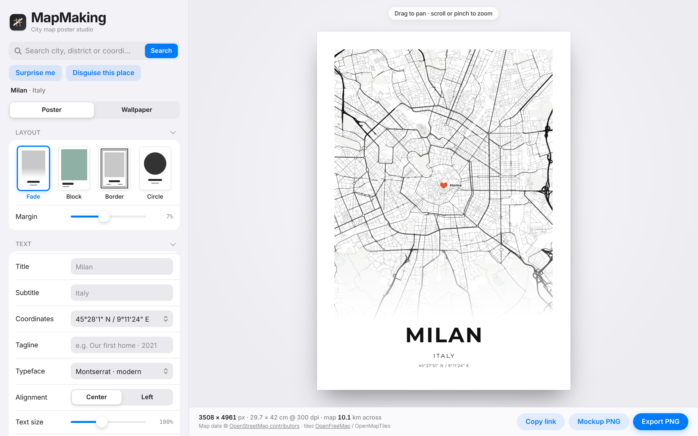
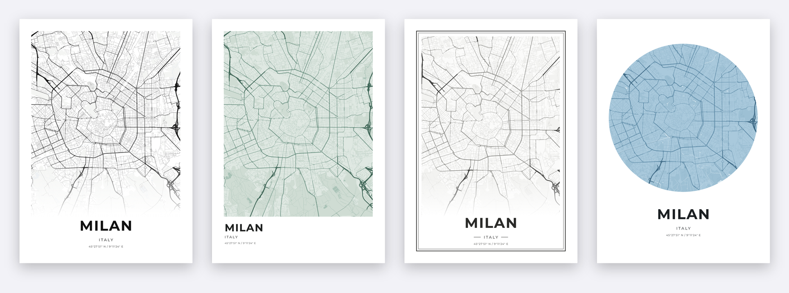
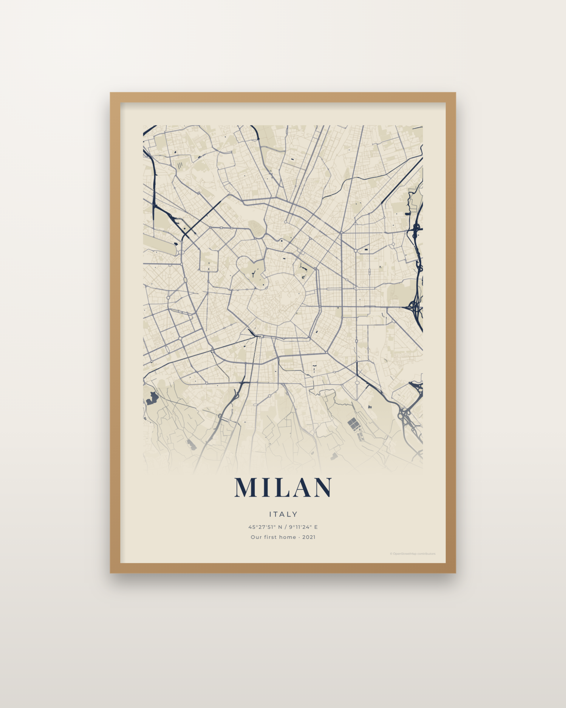
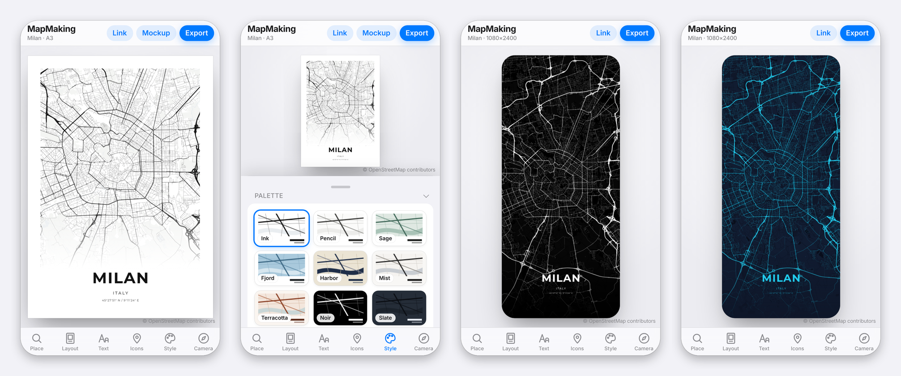

# MapMaking

Design minimalist city map posters and wallpapers from real OpenStreetMap data, right in the browser. Search any place, pick a layout and palette, add your own icons, and export a print-ready PNG or a framed mockup. It works on desktop and on iPhone.

**Live app:** https://guilhermelimait.github.io/MapMaking/

[](https://ko-fi.com/guilhermelimait)



## Features

**Posters**
- Seven layouts: **Fade** (the map fades into the paper), **Block** (a colored map panel with left-aligned text), **Border** (double-line frame), and map shapes **Circle**, **Heart**, **House** and **Hexagon**.
- Text block with title, subtitle, coordinates and an optional tagline. Search fills in the city and country automatically.
- Coordinates as degrees/minutes/seconds, decimal, or "latitude | longitude".
- Six poster typefaces: Montserrat, Jost, Space Mono, Playfair Display, Cormorant Garamond and Barlow Condensed.
- Print sizes A4, A3, A2, 30×40, 40×50, 50×70 cm, square, and 8×10 to 24×36 in, in portrait or landscape, at 150 or 300 dpi.



**Map styling**
- 27 palettes in three groups: **Light** print styles (Ink, Pencil, Sage, Fjord, Harbor, Mist, Terracotta, Sepia), **Dark** wallpaper styles (Noir, Slate, Tron, Blueprint, Ember, Moss, Neon) and 12 **Inspired by games** (Fallout, GTA V, Zelda, Minecraft, Pokémon, Cyberpunk, Hollow Knight, Pac-Man, Super Mario, Red Dead, Halo, Portal). Each of the 12 colors can also be set by hand.
- Separate on/off and line weight for highways, avenues, connectors, streets, service roads, paths and railways. Optional water, parks, buildings and tunnels, plus glow and edge fade.
- Rotation, a 0–60° tilt and three street-detail levels.

**Icons and points of interest**
- Add icons at the map center or by tapping the map: map pin, heart, star, home, flag, plane, target or dot. Each icon has its own color and an optional label.
- Optional points from OpenStreetMap: stations, cafés and restaurants, nightlife, culture, shops.

**Routes and journeys**
- Upload a GPX or GeoJSON file (Strava, Garmin, Komoot…) to draw a run, ride, hike or road trip as a highlighted line with start and finish dots. The file stays on your device.
- Connect your icons with a solid, dashed or dotted line, straight or curved, for "where we met → first home → today" posters.

**Print**
- **Print PDF** sized in mm for print shops, with optional 3 mm bleed and crop marks.
- Map shapes: Circle, Heart, House and Hexagon, besides the Fade, Block and Border layouts.

**Framed mockups**
- Preview the poster framed on a wall (black, oak, walnut or white frame, optional mat, six wall colors).
- **Mockup PNG** saves that scene for shop listings or social posts.



**Wallpapers**
- Phone, tablet, handheld and desktop sizes up to 5K, with the text on top of the map.

**Game cities**
- 16 real places that famous games are set in or modelled on, each with a matching palette: Los Angeles (GTA V), New York (GTA IV), Miami (Vice City), Florence (Assassin's Creed II), Paris (Assassin's Creed Unity), Chicago, San Francisco and London (Watch Dogs), Kabukichō (Yakuza), Shibuya (Persona 5), New Orleans (Red Dead Redemption 2), Washington D.C., Boston and Las Vegas (Fallout), Pittsburgh (The Last of Us) and Guanajuato (Forza Horizon 5).
- The poster shows the game name as the title with the real city and country underneath. Surprise me sometimes picks one of these too.
- The maps are drawn from OpenStreetMap; no game artwork is included.

**More**
- **Disguise this place** rotates, optionally mirrors and renames the map, so a real city becomes a fictional one. **Show real place** undoes it.
- Every section has its own reset button (with Undo), and **Reset all settings** at the bottom of the panel starts over completely.
- **My designs** saves favourite designs in your browser to reopen later.
- Every setting is stored in the page link. **Copy link** (or **Link** on iPhone) brings back the exact same design later.

## iPhone

The layout switches to a full-screen preview with a bottom tab bar. Each tab opens its settings as a sheet. Drag to pan, pinch to zoom, and **Export** opens the share sheet so the image can go straight to Photos. In Safari, **Share → Add to Home Screen** installs it with its own icon.



iPhones cannot create images larger than about 16 megapixels. Large print formats are scaled down to fit (A3 at 300 dpi saves at 288 dpi), and the app says when that happens. Use a computer for full-size print files.

## Using it

1. Search for a city, district or coordinates (for example `45.4642, 9.19`), or tap **Surprise me** for a random city with a random palette, layout, typeface and sometimes a tilted or rotated view.
2. Drag and zoom the map until the framing looks right.
3. Choose a layout, palette, size and text.
4. Click **Export PNG** or **Print PDF** for the print file, or **Mockup PNG** for the framed scene.

## Running and deploying

MapMaking is a single static file (`index.html`, about 1 MB) with no server or account needed. The map engine is included in the file. Map tiles, search and fonts load from the internet.

- **GitHub Pages:** in the repo, go to Settings → Pages, set the source to the `main` branch and `/ (root)`, and save. The app appears at `https://guilhermelimait.github.io/MapMaking/`.
- **On a computer:** double-click `index.html` to open it in Chrome, Edge or Safari.

On iPhone it has to be opened from a web address, such as GitHub Pages. HTML files opened from Files or iCloud do not run.

## Project structure

```
index.html            Built app: open or deploy this file
src/index.src.html    Source (HTML, CSS and JavaScript)
src/icon-180.png      Home-screen icon
build.py              Inlines MapLibre GL JS and the icon into index.html
screenshots/          Images used in this README
```

To change the app, edit `src/index.src.html` and run:

```
python3 build.py
```

The first build downloads MapLibre GL JS 4.7.1 with `npm` into `vendor/` (ignored by git).

## How it works

- **Rendering:** [MapLibre GL JS](https://maplibre.org) draws OpenStreetMap vector tiles with a style generated from the current settings. Exports render the map off-screen at the full output size, then draw the text, icons, fade and border on a canvas.
- **Tiles:** [OpenFreeMap](https://openfreemap.org) (OpenMapTiles schema). No API key is needed.
- **Search:** [Nominatim](https://nominatim.org), with [Photon](https://photon.komoot.io) as a fallback.

## Limitations

- Cafés, shops and other small places appear only from zoom 14 (or zoom 12 with street detail set to Max). Stations show at every zoom.
- Very large exports depend on the graphics card. If it limits the canvas, the map part is scaled up and the app shows a notice.
- Nominatim is a free shared service meant for light use. It is fine for searching places by hand, not for automated bulk requests.

## Credits and licenses

- Map data © [OpenStreetMap contributors](https://www.openstreetmap.org/copyright), available under the Open Database License. Keep the credit on posters you share or sell; the export includes it by default (Text → OpenStreetMap credit on export).
- Vector tiles by [OpenFreeMap](https://openfreemap.org), using the [OpenMapTiles](https://openmaptiles.org) schema.
- [MapLibre GL JS](https://github.com/maplibre/maplibre-gl-js) 4.7.1, BSD 3-Clause License, bundled in `index.html`.
- The game-inspired palettes are fan color homages. Game names and trademarks belong to their owners; MapMaking is not affiliated with or endorsed by them.
- Print PDF uses [jsPDF](https://github.com/parallax/jsPDF) (MIT), loaded on demand.
- Typefaces from [Google Fonts](https://fonts.google.com), under the SIL Open Font License.

## Support

MapMaking is free and open source. If it helped you make something you like, you can buy me a coffee on [Ko-fi](https://ko-fi.com/guilhermelimait).

## License

MapMaking is released under the [MIT License](LICENSE). The bundled MapLibre GL JS keeps its own BSD 3-Clause License, and map data stays under the Open Database License (see Credits).
